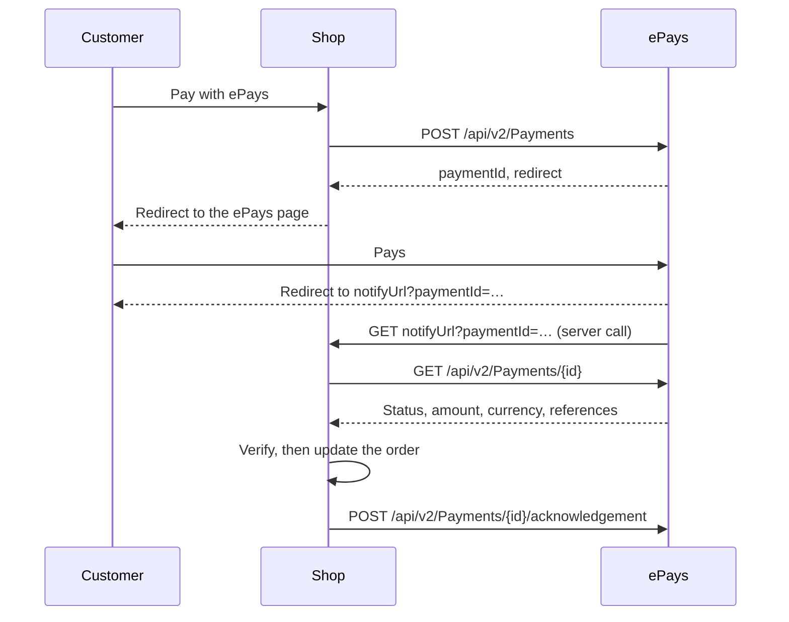

# ePays integration guide

How to take payments through ePays API v2, on a custom site or as a plugin for a shop platform. It
covers the admin UI, starting a payment, the callback, acknowledgement, retries and late charges.

## Start here

| You are building | Follow | Then check your work against |
|---|---|---|
| A **custom integration** for one site | This guide, top to bottom | [PLUGIN_CHECKLIST.md](PLUGIN_CHECKLIST.md), using its *What applies to you* table |
| A **plugin** for a shop platform | This guide, then Part 1 of the checklist before you write code | The whole checklist |

This guide says **how** to do each step. The checklist says **what must be true** before you go live,
and holds the 24 test scenarios. "The existing plugins" means the Odoo addon and the WooCommerce plugin,
which both work this way.

> **Newer servers.** `inFlight`, `inFlightUntil`, `lateCapture` and 409 `PAYMENT_IN_FLIGHT` come with an
> ePays API version not yet in production on 2026-11-06, called a *newer server* below. Handle both
> cases. The sandbox is behind: it has no acknowledgement endpoint yet, and its payment list ignores
> `status` and `udf2`.

## Key terms

| Term | Meaning |
|---|---|
| **Order** | What is being paid. In accounting systems it can also be an invoice |
| **Payment** | One ePays payment, with its own `paymentId`. An order can have several: the customer may retry |
| **Link** | The ePays page URL of a payment (`redirect`). It has an expiry |
| **Replaced payment** | An earlier payment the order stopped using. It can still be charged: see section 6 |
| **Void** | Closing a payment on ePays, so that it can no longer be paid |
| **Gateway** | A way of paying on ePays, such as Card or Benefit. `subscriptionId` names the merchant's own gateway |
| **`udf2`, `udf3`** | Custom reference fields. `udf2` holds the order number |
| **At the bank** | The customer has submitted the payment and the money may be moving: see section 3 |
| **Held** | The order takes no new payment until the merchant releases it: see section 6 |
| **Fils** | One thousandth of a Bahraini dinar (BHD) |
| **Scheduled job** | A task your system runs every 15 minutes: see section 3 |

## How a payment works

The customer pays on the ePays hosted page. The shop never handles card details.



The customer's return and the server call can arrive in either order, and either may never arrive.

**The main rule:** the callback only says which payment to read. It is a plain GET with no signature,
so anyone could call it. The result always comes from `GET /api/v2/Payments/{id}`.

---

## Before you start

Get these from ePays for each shop:

| Item | Notes |
|---|---|
| API ID | One for production, one for sandbox |
| API master key | One for production, one for sandbox. Never reaches a browser or a log |
| Shop domain on the licence | Otherwise 401 `X002_INVALID_LICENSE_DOMAIN` |
| Server's public IP on the licence | Otherwise 401 `X004_INVALID_LICENSE_IP` |
| At least one active gateway | Card, Benefit and so on |
| Sandbox test cards | Ask ePays. This guide does not list any |

You also need a **public HTTPS address** for your callback, even in development. ePays refuses a
`notifyUrl` that resolves to `localhost` or a private address, so use a tunnel on a development machine.

## Quick start

Your first sandbox payment, before you write any code. Each step's curl command is in the section
named.

1. Set the variables in *Trying the calls with curl*, in the next section.
2. Check your access with `GET /api/v2/Payments?limit=1` (section 7). A 401 means the domain or IP is
   not on the licence yet: see section 8.
3. Create a payment with `POST /api/v2/Payments` (section 2), using your public `notifyUrl`.
4. Open `data.redirect` from the response in a browser, and pay with a test card.
5. See ePays call your `notifyUrl` with `?paymentId=…`.
6. Read the result with `GET /api/v2/Payments/{paymentId}` (section 3).

Once that works, build sections 1 to 6 in order. Keep the master key on your server: nothing in the
browser ever calls ePays directly.

---

## API basics

### Base URLs

| Mode | URL |
|---|---|
| Production | `https://api.epays.io` |
| Sandbox | `https://testapi.epays.io` |
| Localhost, development only | `https://localhost:7124` |

### Headers

| Header | Required | Value |
|---|---|---|
| `X-Api-Id` | Yes | The API ID of the mode |
| `X-Api-Master-Key` | Yes | The master key of the mode. Headers only: ePays refuses it in a query string or body |
| `X-Merchant-Domain` | Yes | The shop's domain, as on the licence. Example: `shop.example.com` |
| `Accept` | Recommended | `application/json` |
| `User-Agent` | Recommended | Platform, plugin version and site. ePays stores it to trace a payment back to a shop. Example: `Odoo/18.0 payment_epays/18.0.1.0.7 (db prod; site shop.example.com)` |
| `Content-Type` | With a JSON body | `application/json` |
| `Idempotency-Key` | Create only, see below | 1 to 64 letters, digits, `-` or `_` |

Make every call over verified HTTPS, and refuse redirects so the key is never resent elsewhere.

### Trying the calls with curl

The curl examples use these variables, so a key never appears in a command or your shell history. Run
them in Bash or Git Bash. Start on the sandbox, and paste the key at the `read` prompt.

```sh
export EPAYS_URL=https://testapi.epays.io
export EPAYS_API_ID=<api-id>
export EPAYS_DOMAIN=shop.example.com
read -rs EPAYS_MASTER_KEY && export EPAYS_MASTER_KEY
```

curl does not follow redirects unless asked to, so leave out `-L`, and do not use `-k` outside
Localhost mode. Run `unset EPAYS_MASTER_KEY` when you finish.

### Responses

Every response uses the same envelope. Treat `status` of `ERROR` as a failure, even on HTTP 200.

```json
{
  "status": "SUCCESS",
  "data": { },
  "meta": { }
}
```

On failure, `error` holds the details:

```json
{
  "status": "ERROR",
  "error": {
    "code": "PAYMENT_NOT_VOIDABLE",
    "message": "Only a pending or failed payment can be voided",
    "details": { "reason": "…" },
    "messages": { "en": "…", "ar": "…" }
  }
}
```

### Common errors

| HTTP | Code | Meaning |
|---|---|---|
| 401 | `X000_MISSING_LICENSE` | No usable credential sent |
| 401 | No reason given | Wrong API ID or key |
| 401 | `X002_INVALID_LICENSE_DOMAIN` | Domain not on the licence |
| 401 | `X004_INVALID_LICENSE_IP` | Server IP not on the licence |
| 401 | `TOO_MANY_ATTEMPTS` | Too many failed attempts. Stop and fix the credentials |
| 429 | | Rate limit reached |

For a 401, the reason is in `error.details.reason`. Show it to the admin in plain words, and never show
it to a customer.

---

## 1. Admin UI

### Connection settings

Every plugin must have these six, on one screen, for administrators only. A custom integration with
no admin screen can keep them in server configuration, and test the connection with the curl command in
section 7.

| Setting | Type | Required | Rules |
|---|---|---|---|
| API ID | Text | Yes | The production pair, with the master key |
| API Master Key | Password | Yes | See *Master key fields* below |
| Sandbox API ID | Text | No | The sandbox pair, with the sandbox key. Used in Sandbox and Localhost modes |
| Sandbox API Master Key | Password | No | See *Master key fields* below |
| Mode | Choice | Yes | Production (default), Sandbox or Localhost. Sets the API URL and which credentials are used, and is stored on every payment |
| Test connection | Button | | See below |

The sandbox fields work as a pair. Outside Production, they are used only when both are filled in.
Otherwise the production pair is used, with `testMode` still true.

**Master key fields**

- Never show a stored key. The field stays empty or shows `********`, and saving the mask keeps the key.
- Store it encrypted, with the prefix `epays1:`.
- Refuse a key sent over plain HTTP, except in Localhost mode.
- If a stored key can no longer be read, warn the admin. Do not fall back on the other key.

**Test connection**

1. Allow it only for users who can change the settings.
2. Use the saved settings of the selected Mode. It tests that mode only, so switch Mode to test the
   other pair.
3. If the API ID or master key of that mode is missing, say so and call nothing.
4. Otherwise call `GET /api/v2/Payments?limit=1`. It changes nothing on ePays.
5. Show the result, naming the mode, the API URL and the merchant domain.

| Result | Tell the admin |
|---|---|
| Success | The connection works |
| 401 `X002_INVALID_LICENSE_DOMAIN` | The domain shown is not on the licence |
| 401 `X004_INVALID_LICENSE_IP` | This server's IP is not on the licence. ePays reports the IP it saw in `error.details.observedIp`: show it, and keep it for the next button |
| 401 `X000_MISSING_LICENSE` | ePays received no usable credential |
| 401 `TOO_MANY_ATTEMPTS` | Wait, and fix the credentials before trying again |
| Any other 401 | Check the API ID and master key of this mode. ePays gives no reason for a wrong ID or key, on purpose |
| No connection | ePays could not be reached. Show the reason without any credential in it |

This button is the only place a detailed failure is shown. Customers only ever see a generic message.

### Other settings

| Setting | Type | Notes |
|---|---|---|
| Merchant domain | Text or automatic | Odoo has a setting. WooCommerce always uses the site's host |
| Sandbox visibility | Switch | Staff only by default. Administrators only |
| Payment page language | Choice | Customer's language (default), English or Arabic |
| Payment link expiry | Minutes | Default 60 |
| Customer details | Switch | Send the customer's name, email, phone and address. Default on |
| Exchange rates to BHD | Platform or manual | For shops not selling in BHD |

### Other buttons

| Button | What it does | API |
|---|---|---|
| Find this server's IP address | Shows the IP to give ePays. It asks ePays first, as a refusal reports the exact address ePays saw. Otherwise it asks a public IP service, with no credentials | `GET /api/v2/Payments?limit=1` |
| Sync from ePays | Reads the active gateways, to offer single payment methods | `GET /api/v2/gateways?limit=100` |

### Warnings on the settings page

- A stored key can no longer be read
- Sandbox is shown to customers
- No exchange rate to BHD
- The exchange rate is over 7 days old

### On each order

| Item | Purpose |
|---|---|
| Payment details | Status, payment ID, environment, charged amount, rate, gateway response |
| Check ePays status | Reads the current and all replaced payments, at any age, with no read limit |
| Allow a new payment | Shown when a charge did not match. Releases the order for a new payment |

### Payment methods

Offer one generic **ePays** method by default, where the customer chooses on the ePays page. Single
methods are optional and need a matching active gateway after a sync.

| `gatewayTypeId` | Method | Billing countries |
|---|---|---|
| 1 | Benefit | BH |
| 2 | Card | Any |
| 3 | Google Pay | Any |
| 4 | Apple Pay, only on browsers with `ApplePaySession` | Any |
| 5 | Tabby | BH, SA, AE, KW |
| 6 | BenefitPay | BH |
| 7, 8 | Platform integrations: never offer at checkout | |
| 9 | Samsung Pay | Any |

---

## 2. Initiate payment

### Before the request

If the order has an earlier payment, follow section 5 first. Otherwise work out these four values.

**Amount in BHD.** ePays charges only in BHD, so your code converts before it calls ePays, using your
platform's rate. ePays refuses anything else with 422 `CURRENCY_NOT_SUPPORTED`. Round to 3 decimals,
and record the rate. If there is no rate, do not offer ePays, and never charge 1:1.

```text
100.00 USD × 0.376 = 37.600 BHD
```

**Language.** An Arabic website must open the ePays page in Arabic.

```text
if the admin fixed a language:            use it
else if the customer's page starts "ar":  lang = "ar"
else:                                     lang = "en"
```

Use the language of the page the customer ordered from, not the language saved on their account.

**Expiry.** ePays reads `expiryDate` in Bahrain time (UTC+3), with no offset.

```text
expiryDate = UTC now + link expiry + 3 hours
12:30 UTC + 60 minutes + 3 hours = 16:30 in expiryDate
```

**Idempotency key.** Build one from the site, the order and an attempt number you store on the order
and increase each time. The key is 64 hexadecimal characters.

```text
sha256(site address + "|" + order id + "|" + attempt number)
```

### Request

`POST /api/v2/Payments`

Save the body below as `payment.json`, with an `expiryDate` in the future, then run:

```sh
curl -sS --max-time 30 -X POST "$EPAYS_URL/api/v2/Payments" \
  -H "X-Api-Id: $EPAYS_API_ID" \
  -H "X-Api-Master-Key: $EPAYS_MASTER_KEY" \
  -H "X-Merchant-Domain: $EPAYS_DOMAIN" \
  -H "Accept: application/json" \
  -H "Content-Type: application/json" \
  -H "User-Agent: MyPlatform/2.1 epays-plugin/1.0.0 (site $EPAYS_DOMAIN)" \
  -H "Idempotency-Key: $(openssl rand -hex 16)" \
  --data-binary @payment.json
```

```json
{
  "amount": "37.600",
  "currency": "BHD",
  "description": "Order 1001",
  "notifyUrl": "https://shop.example.com/epays/return/sandbox",
  "merchantUrl": "https://shop.example.com",
  "merchantDomain": "shop.example.com",
  "testMode": true,
  "lang": "ar",
  "expiryDate": "2026-11-06T15:30:00",
  "customFields": {
    "udf2": "1001",
    "udf3": ""
  },
  "customer": {
    "fullName": "Sara Ahmed",
    "email": "sara@example.com",
    "mobile": "+97333000000",
    "country": "BH",
    "city": "Manama"
  },
  "order": {
    "taxAmount": "3.100",
    "shippingAmount": "2.000",
    "discountAmount": "0.000",
    "lineItems": [
      { "name": "Blue shirt", "quantity": 2, "unitPrice": "17.800", "sku": "SHIRT-BL" }
    ]
  }
}
```

### Parameters

| Field | Required | Limit | Value |
|---|---|---|---|
| `amount` | Yes | Up to 9999999999 | The charge, with 3 decimals. Send a string so that no precision is lost |
| `currency` | Yes | | `BHD` |
| `description` | Yes | 255 | "Order N" in the payment language |
| `notifyUrl` | Yes | 250 | Public URL of your return route, with the environment in it. No quotes or `<>`. An address that does not resolve publicly gets `INVALID_NOTIFY_URL` |
| `merchantUrl` | Yes | | The site's address |
| `merchantDomain` | No | | The shop's domain, recorded on the payment |
| `testMode` | No | | Default `false`. Send `true` for anything but production |
| `lang` | No | | `en` or `ar`, default `en`. Sets the ePays page language |
| `expiryDate` | No | Future | `YYYY-MM-DDTHH:MM:SS` in Bahrain time (UTC+3), no offset. **Without this or `expiryDays`, the link lasts 30 days.** Send it: the plugins use 60 minutes |
| `expiryDays` | No | 1 min to 365 days | Alternative to `expiryDate`, which wins if both are sent. The plugins do not use it |
| `subscriptionId` | No | | The gateway to open directly, from the sync. Leave it out to let the customer choose. Also send it as `gatewayId` for servers not yet updated |
| `customFields` | No | `udf2`, `udf3`: 255 | `udf2` is the order reference, `udf3` the invoice references or empty |
| `customer` | No | | See below |
| `order` | No | | See below |
| `trackId` | No | 5 to 18 digits | Your own tracking number. Generated if left out. The plugins do not use it |
| `apiVersion` | No | | Default `2.0`. The plugins do not use it |
| `gatewayOptions` | No | | Per-payment gateway settings. The plugins do not use it |

**Do not send `udf6` to `udf10`.** ePays reads them as gateway settings, and refuses `udf6` to `udf9` on
v2. Use `User-Agent` to identify the shop.

#### `customer`

Leave out empty values.

| Field | Limit | Field | Limit |
|---|---|---|---|
| `fullName` | 255 | `state` | 100 |
| `email` | 255 | `zipCode` | 100 |
| `mobile` | 50 | `addressLine1` | 255 |
| `phone` | 50 | `addressLine2` | 255 |
| `country` | 50 | `city` | 100 |

ePays also accepts `note`, `dateOfBirth`, `loyaltyPoints`, `ip` and `userAgent`. The plugins do not send
them.

#### `order`

| Field | Value |
|---|---|
| `taxAmount`, `shippingAmount`, `discountAmount` | In BHD |
| `lineItems[].name` | Required for a line, up to 255 characters |
| `lineItems[].quantity` | Whole number |
| `lineItems[].unitPrice` | In BHD |
| `lineItems[].sku` | Optional |

**Send `lineItems` only when they add up exactly.** Tabby recomputes the charge as
`sum(unitPrice × quantity) + shippingAmount`, without tax or discount. Add in fils as integers. If the
result differs from `amount` by even one fils, leave the lines out, and ePays keeps `amount`.

### `Idempotency-Key`

ePays treats it as optional, but always send one.

- Use a new key for each attempt, and the same key if you repeat that attempt.
- The same key with different fields gets 409 `IDEMPOTENCY_CONFLICT`.
- While the first request runs, a repeat gets 409 `IDEMPOTENCY_IN_PROGRESS`.
- A replay works for 24 hours.
- Do not build it from a value that comes back after a database rollback.

### Response

201 for a new payment. Repeating a key returns the first reply. Without a key, ePays may return an
existing pending payment for the same references, with 200.

```json
{
  "status": "SUCCESS",
  "data": {
    "paymentId": "PAY1001",
    "redirect": "https://api.epays.io/…",
    "expiryDate": "2026-11-06T15:30:00+03:00"
  }
}
```

| HTTP | Meaning |
|---|---|
| 400 | Invalid field. See `error.code` |
| 401 | Credentials, domain or IP |
| 403 | Refused for this merchant |
| 409 | Idempotency conflict |
| 422 | `CURRENCY_NOT_SUPPORTED` |
| 429 | Rate limit |

### After the response

1. Check that `redirect` is HTTPS on the API's host. Refuse it otherwise.
2. Store the values below. Nothing goes in the session: the callback has none.
3. Redirect the customer to `redirect`.

### What to store

Keep one record per payment, tied to the order, and **keep the record when a payment is replaced**.

| Value | Why |
|---|---|
| Payment ID and environment | The only way to find the order from a callback |
| Expiry | Decides reuse, voiding and how long to watch |
| Payment link | To reuse it. Anyone holding it can pay, so keep it out of logs and API responses |
| Charged amount, currency, rate, rate source | To verify the result, and for the merchant |
| Order total when created | To tell whether the order changed since |
| `udf2`, `udf3` | To verify the result |
| Language | To write messages in the customer's language |
| Gateway requested | To tell whether the customer changed method |
| Attempt number | For the idempotency key |
| Last status, at-bank flag, watch-until time | For the scheduled job |
| Needs-review flag and customer message | For held orders |
| Transaction ID, gateway reference, response code, gateway response | For the merchant |

### If the request times out

Use a 30-second timeout. On a timeout, ePays may still have created the payment. Record the order in a
way that survives a rollback. After 2 minutes, a scheduled job finds and voids any pending payment no
attempt holds, using `GET /api/v2/Payments?status=pending&udf2=<order>&limit=100`.

---

## 3. Callback

### What ePays calls

Your `notifyUrl` receives two kinds of request, both with `paymentId` added to the query string:

| Request | From | Notes |
|---|---|---|
| Server notification | ePays | `GET`. Tried up to 3 times |
| Customer return | Customer's browser | May arrive without a session cookie. Accept `GET` and `POST` |

```text
https://shop.example.com/epays/return/production?paymentId=PAY1001
```

Use one route for both, and put the environment in the URL, because sandbox and production number
their payments independently.

ePays follows redirects and counts a final 2xx page as delivered, **even if your read failed**. So keep
a scheduled job as the safety net.

### Steps

```text
1.  Reject a paymentId that does not match ^[A-Za-z0-9_-]{1,64}$, with no lookup
2.  Check the environment against the fixed list
3.  Find the order by stored paymentId and environment, never by anything else in the request
    No match: log it, and send the customer to the cart
4.  Take the order's lock, as the return and the server call can arrive together
5.  Stop if this payment already paid the order
6.  Limit reads: at most 5 a minute per payment
7.  GET /api/v2/Payments/{paymentId}
8.  Map the status
9.  If completed, verify the amount, currency, udf2 and udf3 against what was stored
10. Update the order
11. Acknowledge (section 4)
12. Redirect to a page chosen from the order, never from the request
```

If step 6 or 7 cannot run, hand the payment to the scheduled job, and still redirect the customer. A
replaced payment follows section 6 from step 9.

For the read limit, keep a counter per payment that resets after 60 seconds, in a store shared between
your workers if you have one. The limit stops a script from using up your ePays rate limit.

### Where the customer lands

| Result | Show |
|---|---|
| Paid | Order confirmation |
| Pending or at the bank | A waiting page, see below |
| Declined or cancelled | The payment step, with the cart kept and the reason shown, so they can retry |
| Held, or a charge you refused | The order page, asking them to contact the shop |

The waiting page polls your own status endpoint every few seconds. That endpoint checks the order's
access key, reads ePays within the read limit, and returns the order's state. Never ask the browser to
call ePays.

Show the reason from `responseDescription`, in the payment's language. Never show a customer a technical
error.

### Read the payment

`GET /api/v2/Payments/{paymentId}`, with the standard headers and no body.

```sh
curl -sS --max-time 10 "$EPAYS_URL/api/v2/Payments/PAY1001" \
  -H "X-Api-Id: $EPAYS_API_ID" \
  -H "X-Api-Master-Key: $EPAYS_MASTER_KEY" \
  -H "X-Merchant-Domain: $EPAYS_DOMAIN" \
  -H "Accept: application/json"
```

```json
{
  "status": "SUCCESS",
  "data": {
    "paymentId": "PAY1001",
    "transactionId": "TXN-0001",
    "result": "CAPTURED",
    "status": "completed",
    "responseCode": "00",
    "responseDescription": { "en": "Approved", "ar": "تمت الموافقة" },
    "amount": "37.600",
    "currency": "BHD",
    "subscriptionId": "32267213",
    "createdAt": "2026-11-06T14:30:33+03:00",
    "completedAt": "2026-11-06T14:33:00+03:00",
    "paymentLang": "ar",
    "testMode": false,
    "customFields": { "udf2": "1001", "udf3": "" },
    "gatewayReference": "GW-REF-1",
    "gatewayResponse": { "cardBrand": "VISA", "rrn": "123456789012" },
    "inFlight": false
  }
}
```

| Field | Use |
|---|---|
| `status` | The result. If empty, read `result`, as older servers send only that |
| `responseCode` | `00` means approved |
| `responseDescription` | Decline reason in `en` and `ar`, for the customer |
| `amount`, `currency` | Must match what you stored |
| `customFields` | `udf2` and `udf3` must match, after trimming |
| `transactionId` | Set when the customer pays. See *At the bank* below |
| `inFlight` | The customer's money may be moving now. Newer servers only |
| `lateCapture` | A voided payment was charged. Newer servers only |
| `paymentLang` | The language the page opened in. Use it for messages |
| `completedAt` | Older servers send `paidAt` |
| `notifyDelivery` | How the notification went: `status`, `attempts`, `lastError`, `lastHttpStatus` |
| `subscriptionId` | Older servers send `gatewayId` |

ePays renames fields, and servers update at different times, so read the new name, then the old one.

### Map the status

Compare after trimming and ignoring case.

| ePays values | Outcome | Action |
|---|---|---|
| `completed`, `captured`, `approved` | Done | Verify, then mark the order paid |
| `failed`, `declined`, `error` | Error | Show the reason, allow a retry |
| `cancelled`, `canceled`, `expired`, `voided` | Cancel | Not paid, allow a retry |
| `pending`, `3ds authentication initiated` | Pending | Keep waiting |
| `refunded` | Refunded | Never mark paid |
| Anything else | Unknown | Change nothing |

**Do not mark an order paid on a mismatch.** Hold it and tell the merchant and the customer.

### At the bank

A payment is with the bank when it is pending with a `transactionId`, or when `inFlight` is true on a
pending or failed payment. Do not void it on a retry, or start a second payment: tell the customer it
is still being confirmed. ePays refuses such a void with 409 `PAYMENT_IN_FLIGHT`.

### Scheduled job

Run it every 15 minutes. It finishes the payments of customers who closed their browser.

- Read payments aged 5 minutes to 3 days.
- Read declined payments until their link expires.
- Void links expired by more than 30 minutes.
- Void the open links of cancelled orders.
- Keep reading voided or replaced payments until `max(link expiry + 30 min, replaced + 2 h)`, as they
  can still be charged.

### When ePays corrects a payment later

A customer says the money was taken, and ePays finds it true. ePays must correct the status first, then
call `POST /api/v2/Payments/{paymentId}/notify-deliveries` (see section 7).

That sends your `notifyUrl` a new notification, even for an acknowledged payment. Your route must
therefore read and apply a payment at any age. The merchant's *Check ePays status* button does the same
from the shop side.

---

## 4. Acknowledgement

The acknowledgement tells ePays the shop has dealt with a payment. ePays's unacknowledged list is the
merchant's to-do list, so what is left on it should be only what needs action.

### Request

`POST /api/v2/Payments/{paymentId}/acknowledgement`, with the standard headers. It needs no body.

```sh
curl -sS --max-time 5 -X POST "$EPAYS_URL/api/v2/Payments/PAY1001/acknowledgement" \
  -H "X-Api-Id: $EPAYS_API_ID" \
  -H "X-Api-Master-Key: $EPAYS_MASTER_KEY" \
  -H "X-Merchant-Domain: $EPAYS_DOMAIN" \
  -H "Accept: application/json"
```

The sandbox has no such endpoint yet, so this call answers 404 there.

### Response

```json
{
  "status": "SUCCESS",
  "data": {
    "paymentId": "PAY1001",
    "acknowledgedAt": "2026-11-06T14:33:05+03:00",
    "firstAcknowledgement": true
  }
}
```

A repeat is harmless: it returns the first time, with `firstAcknowledgement` false. An unknown payment
gets 404.

### When to send it

| Payment | Acknowledge? |
|---|---|
| Completed, and recorded on the order | Yes |
| Declined, with no money taken | Yes |
| Cancelled or expired, with no money taken | Yes |
| Voided by the shop | Yes, right after the void |
| Completed, but the order refused it (mismatch, second charge) | **No:** the merchant must act on it |
| Failed or cancelled with response code `00` | **No:** money was taken |
| Refunded | **No** |

### Rules

- Send it after the order's change is saved, on a 5-second timeout.
- A failure only gets logged. It must never fail the payment. Older servers answer a bare 404.
- ePays clears the mark if a payment later completes through its callback, so acknowledging a declined
  payment cannot hide a later charge.
- List what is left with `GET /api/v2/Payments?acknowledged=false`.

---

## 5. Retries and voids

A customer may press Back and pay again. **An order must never have two payable links.** A declined
link stays payable on ePays, so it counts as open.

Run this before creating any payment, while holding the order's lock:

```text
if the order is paid: show its confirmation, stop

for each replaced payment whose link would still be open:
    read it
    completed:     settle the order (section 6), no new payment, stop
    at the bank:   tell the customer it is still being confirmed, stop

if the order is held: show its message, stop

read the current payment, if there is one:
    completed:     settle the order, stop
    pending:
        unchanged and at least 5 minutes left:   reuse its link, stop
        at the bank and its link is live:        "still being confirmed", stop
        otherwise:                               void it
    failed or unknown:                           void it
    cancelled, expired, voided or refunded:      apply it, and carry on

create a new payment (section 2)
```

**Unchanged** means the amount, currency, gateway and language are what a new payment would send.

Do every read before any void. If a later step fails and your request rolls back, the void on ePays
stays done.

### Voiding

| Result | Do |
|---|---|
| Voided | Keep the payment as replaced, start watching it (section 6), and acknowledge it |
| Refused, for any reason | Read it again |
| Read: completed | Settle the order |
| Read: at the bank | "Still being confirmed", no new payment. Try the void again later |
| Read: anything else | No new payment. Ask the customer to try again |

### Once a payment settles the order

Void the order's other open payments, declined ones too, except any at the bank. The scheduled job
voids those once ePays allows it.

### When the order is cancelled

Void its open link, even at the bank. If your platform cannot tell you about a cancellation, the
scheduled job does it.

---

## 6. Late charges

A void cannot always stop a customer who is already past the ePays page, and ePays can correct a payment
days later. So ePays's status is the truth, even for a payment you voided.

### Watching

Keep reading each replaced payment in the scheduled job until:

```text
normally:     max(link expiry + 30 minutes, replaced + 2 hours)
at the bank:  max(link expiry, replaced) + 3 days
```

The callback reads it at any age. A replaced payment changes the order only if ePays reports it
completed. Anything else leaves the order alone.

### When one completes

Take the order's lock, and ask your system what is due now.

| Situation | Do |
|---|---|
| The order's current payment, order unchanged, amount as stored | Mark paid, even if the rate moved since |
| A replaced payment that equals what a new payment would charge now | Mark paid, void the other payment |
| It does not match, or it is above what is due | Record nothing, stop other payments, **hold the order** |
| Below what is due | Hold the order, or keep it as a partial payment if your system has them |
| The order is already paid | Record nothing, leave it for a refund on ePays |
| The order is cancelled | Your choice, made once and written down: restore it, or refuse the charge |

WooCommerce restores a cancelled order. Odoo refuses the charge, as reopening an order there can undo
stock and invoice steps.

Whenever money is not recorded, do not acknowledge the payment, and tell:

- **The merchant:** a note on the order, a warning in the log, and an email.
- **The customer:** a message on the order page, quoting the reference and asking them to contact you.

### Holding an order

A held order takes no new payment. Give staff an *Allow a new payment* action, and tell them to refund
the charge on ePays first if it is not needed. After the release, that payment stops blocking new ones
and is never applied again.

---

## 7. API reference

Every call uses the standard headers from *API basics*.

| Call | Purpose | Called by |
|---|---|---|
| `POST /api/v2/Payments` | Create a payment | Checkout |
| `GET /api/v2/Payments/{id}` | Read a payment | Callback, scheduled job, status check |
| `POST /api/v2/Payments/{id}/acknowledgement` | Acknowledge | After a result |
| `DELETE /api/v2/Payments/{id}` | Void | Retry, expiry, cancelled order |
| `GET /api/v2/Payments` | List and search | Test connection, orphan cleanup |
| `GET /api/v2/gateways` | List active gateways | Sync from ePays |
| `POST /api/v2/Payments/{id}/notify-deliveries` | Resend the notification | ePays staff, not the plugin |

### `DELETE /api/v2/Payments/{paymentId}`

Voids a pending or failed payment. No body.

```sh
curl -sS --max-time 10 -X DELETE "$EPAYS_URL/api/v2/Payments/PAY1001" \
  -H "X-Api-Id: $EPAYS_API_ID" \
  -H "X-Api-Master-Key: $EPAYS_MASTER_KEY" \
  -H "X-Merchant-Domain: $EPAYS_DOMAIN" \
  -H "Accept: application/json"
```

```json
{
  "status": "SUCCESS",
  "data": {
    "paymentId": "PAY1001",
    "status": "voided",
    "voidedAt": "2026-11-06T14:40:00+03:00"
  }
}
```

| HTTP | Code | Action |
|---|---|---|
| 200 | | Acknowledge the payment |
| 404 | | Unknown payment |
| 409 | `PAYMENT_NOT_VOIDABLE` | Read the payment: it may have been paid |
| 409 | `PAYMENT_IN_FLIGHT` | Read the payment, and try again later |

After any refusal, read the payment and act on what it says, rather than on the code.

`POST /api/v2/Payments/{id}/voids` does the same and records why. The plugins use `DELETE`, as older
servers lack it.

```sh
curl -sS --max-time 10 -X POST "$EPAYS_URL/api/v2/Payments/PAY1001/voids" \
  -H "X-Api-Id: $EPAYS_API_ID" \
  -H "X-Api-Master-Key: $EPAYS_MASTER_KEY" \
  -H "X-Merchant-Domain: $EPAYS_DOMAIN" \
  -H "Accept: application/json" \
  -H "Content-Type: application/json" \
  -d '{"reason": "Customer cancelled the order"}'
```

### `GET /api/v2/Payments`

Needs the master key.

Test connection:

```sh
curl -sS --max-time 10 "$EPAYS_URL/api/v2/Payments?limit=1" \
  -H "X-Api-Id: $EPAYS_API_ID" \
  -H "X-Api-Master-Key: $EPAYS_MASTER_KEY" \
  -H "X-Merchant-Domain: $EPAYS_DOMAIN" \
  -H "Accept: application/json"
```

Find the pending payments of an order, for orphan cleanup:

```sh
curl -sS --max-time 10 "$EPAYS_URL/api/v2/Payments?status=pending&udf2=1001&limit=100" \
  -H "X-Api-Id: $EPAYS_API_ID" \
  -H "X-Api-Master-Key: $EPAYS_MASTER_KEY" \
  -H "X-Merchant-Domain: $EPAYS_DOMAIN" \
  -H "Accept: application/json"
```

List what has not been acknowledged:

```sh
curl -sS --max-time 10 "$EPAYS_URL/api/v2/Payments?acknowledged=false&limit=100" \
  -H "X-Api-Id: $EPAYS_API_ID" \
  -H "X-Api-Master-Key: $EPAYS_MASTER_KEY" \
  -H "X-Merchant-Domain: $EPAYS_DOMAIN" \
  -H "Accept: application/json"
```

Parameters:

| Query | Value |
|---|---|
| `limit` | 1 to 100, default 20 |
| `cursor` | `nextCursor` of the previous page |
| `status` | `pending`, `completed`, `failed`, `error`, `cancelled`, `refunded`, `expired` or `voided` |
| `udf2` | Exact order reference |
| `acknowledged` | `true` or `false` |

`data` holds `payments`, `limit`, `hasMore` and `nextCursor`. Each item has `paymentId`, `status`,
`amount`, `currency`, `udf2`, `subscriptionId`, `inFlight` and more.

### `GET /api/v2/gateways`

Needs the master key. Returns the merchant's activated gateways.

```sh
curl -sS --max-time 10 "$EPAYS_URL/api/v2/gateways?limit=100" \
  -H "X-Api-Id: $EPAYS_API_ID" \
  -H "X-Api-Master-Key: $EPAYS_MASTER_KEY" \
  -H "X-Merchant-Domain: $EPAYS_DOMAIN" \
  -H "Accept: application/json"
```

For the next page, add the `nextCursor` of the previous response:

```sh
curl -sS --max-time 10 -G "$EPAYS_URL/api/v2/gateways" \
  --data-urlencode "limit=100" \
  --data-urlencode "cursor=<nextCursor>" \
  -H "X-Api-Id: $EPAYS_API_ID" \
  -H "X-Api-Master-Key: $EPAYS_MASTER_KEY" \
  -H "X-Merchant-Domain: $EPAYS_DOMAIN" \
  -H "Accept: application/json"
```

| Query | Value |
|---|---|
| `limit` | 1 to 100, default 100 |
| `cursor` | `nextCursor` of the previous page |

```json
{
  "status": "SUCCESS",
  "data": {
    "gateways": [
      {
        "subscriptionId": "32267213",
        "gatewayTypeId": 2,
        "gatewayName": "Card",
        "status": "active"
      }
    ],
    "limit": 100,
    "hasMore": false
  }
}
```

Follow `nextCursor`, up to 10 pages, and replace the stored list only after every page is read. Offer a
gateway only with `status` of `active`. Older servers send `gatewayId` for the type, and `gatewayId` or
`merchantGateway` for the subscription.

### `POST /api/v2/Payments/{paymentId}/notify-deliveries`

Queues a new notification to the payment's `notifyUrl`. No body. An `Idempotency-Key` stops a retry
from notifying twice.

```sh
curl -sS --max-time 10 -X POST "$EPAYS_URL/api/v2/Payments/PAY1001/notify-deliveries" \
  -H "X-Api-Id: $EPAYS_API_ID" \
  -H "X-Api-Master-Key: $EPAYS_MASTER_KEY" \
  -H "X-Merchant-Domain: $EPAYS_DOMAIN" \
  -H "Accept: application/json" \
  -H "Idempotency-Key: $(openssl rand -hex 16)"
```

| HTTP | Code | Meaning |
|---|---|---|
| 202 | | Queued. `data` holds `paymentId` and `queuedAt` |
| 400 | `INVALID_NOTIFY_URL` | The URL is not a public address |
| 404 | | Unknown payment |
| 409 | `NOTIFY_URL_NOT_SET` | The payment has no `notifyUrl` |
| 409 | `PAYMENT_NOT_FINAL` | Still pending: correct the status first |

### Not in scope

Refunds are not part of either integration yet. A refund made on ePays after a payment completed does
not reach the shop.

---

## 8. Troubleshooting

| Problem | Cause | Fix |
|---|---|---|
| 401 with `X002_INVALID_LICENSE_DOMAIN` | The domain is not on the licence, or `X-Merchant-Domain` is missing | Send the header, and ask ePays to add the domain |
| 401 with `X004_INVALID_LICENSE_IP` | Your server's IP is not on the licence | Ask ePays to add the address in `error.details.observedIp` |
| 401 with no reason | Wrong API ID or key, or the wrong pair for this mode | Check both. Stop retrying, or you reach `TOO_MANY_ATTEMPTS` |
| 400 `INVALID_NOTIFY_URL` | The URL is private, over 250 characters, or has quotes or `<>` | Use a public HTTPS address, with a tunnel in development |
| 400 `INVALID_EXPIRY_DATE` | The date is in the past | Use Bahrain time, see section 2 |
| 400 `INVALID_GATEWAY_ID` | That `subscriptionId` is not an active gateway of this merchant | Run *Sync from ePays* again |
| 400 on `customFields.udf6` | `udf6` to `udf9` are refused on v2 | Remove them |
| 409 `IDEMPOTENCY_CONFLICT` | A key was reused with different fields | Use a new key for each attempt |
| 422 `CURRENCY_NOT_SUPPORTED` | The currency is not BHD | Convert first, see section 2 |
| The ePays page is in English on an Arabic site | `lang` was not sent as `ar`, or the admin fixed English | See *Language* in section 2 |
| Tabby charges a different amount | The line items do not add up to `amount` | Leave the lines out unless they match to the fils |
| The callback never arrives | Your URL is unreachable, or a firewall blocks it | Check `notifyDelivery` on the payment. The scheduled job still settles it |
| The customer paid, but the order is not paid | The callback failed or the read did not run | Use *Check ePays status*, or wait for the scheduled job. See section 3 |
| A void answers 409 | It was paid, or the customer is paying now | Read the payment and act on its status, see section 5 |
| The acknowledgement answers 404 | An older server, such as the sandbox | Log it and carry on |
| The sandbox list ignores `status` or `udf2` | The sandbox is behind | Test orphan cleanup on a newer server |
